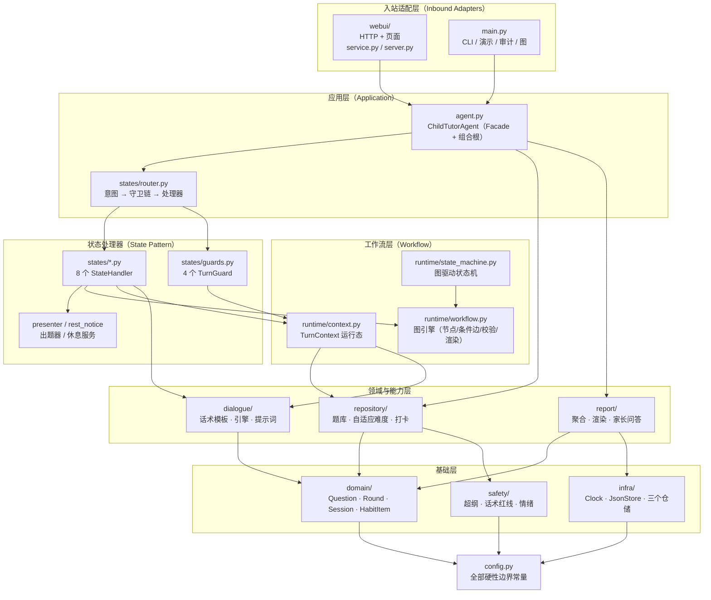
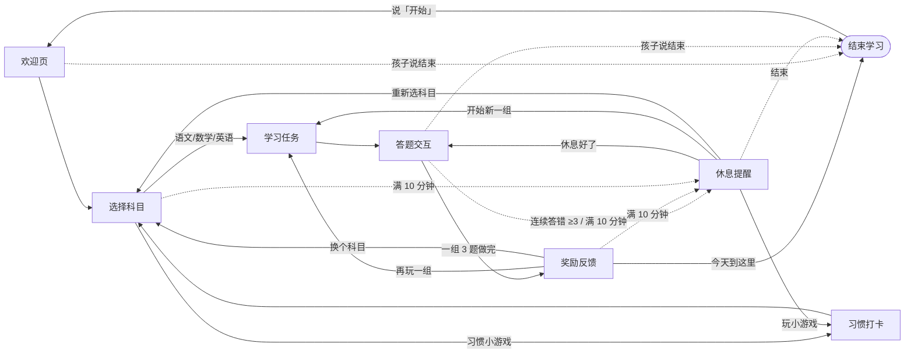
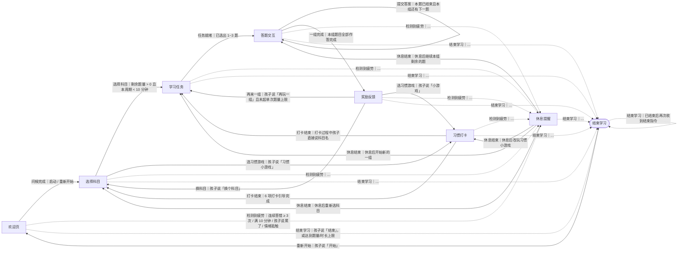
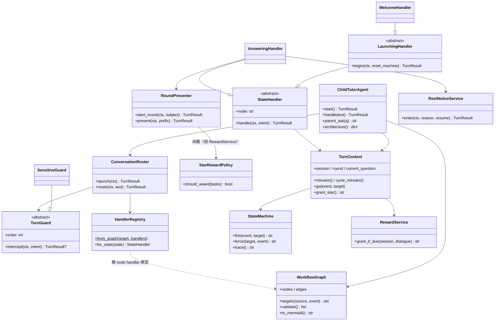
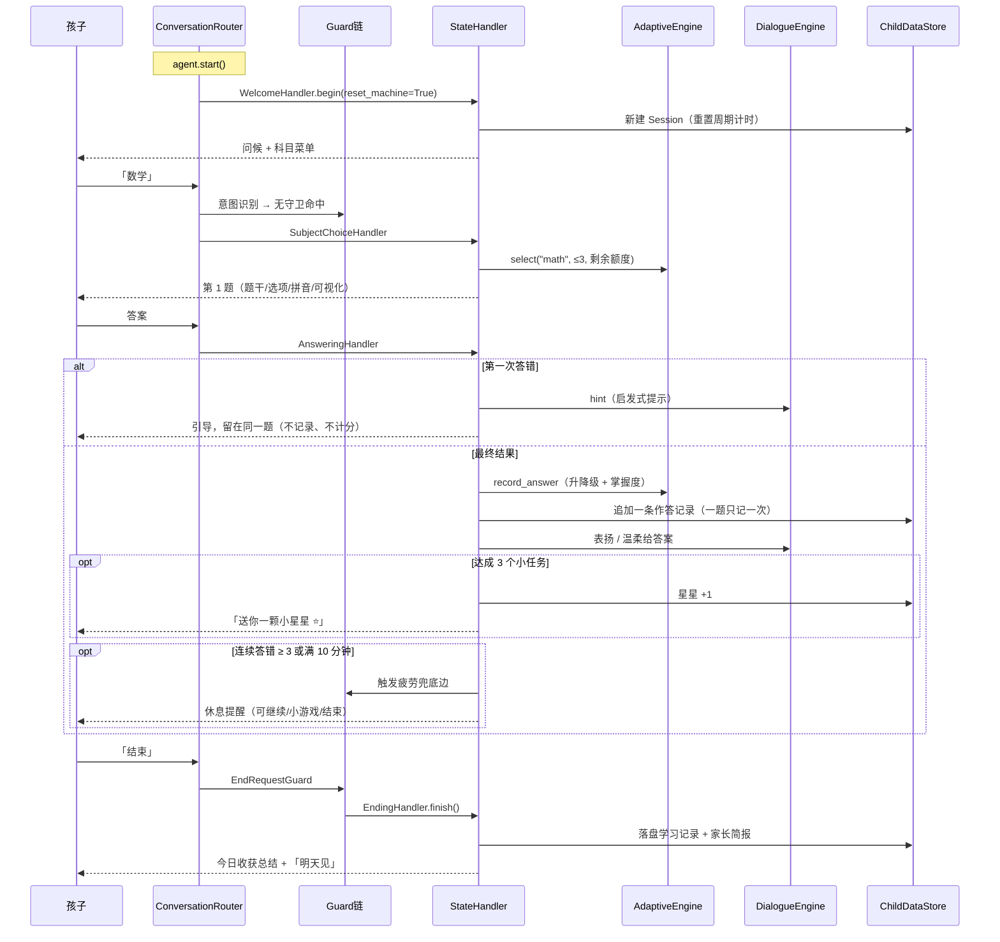
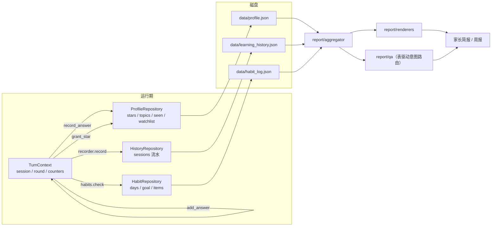

# 架构设计 · 7 岁儿童启蒙教辅 Agent

> 本文档描述系统的**工作流图**与**分层架构**。
> 文中的图不是手绘的，而是由 `python main.py --graph` / `--mermaid` 从代码里直接导出，
> 因此**图与运行时永远一致**，不会出现"文档说 A、代码做 B"的漂移。

---

## 1. 设计目标

| 目标 | 落地手段 |
| --- | --- |
| 业务规则可审计 | 硬性边界全部集中到 `config` + `safety`，并被题库审计、话术审计、架构测试反复验证 |
| 流程可追溯、可演化 | 对话流程是一张**显式有向图**（节点 + 条件边），状态机由图驱动 |
| 一个类一个职责 | 8 个状态 = 8 个处理器类；横切规则 = 4 个守卫类；依赖靠构造注入 |
| 依赖单向、可测试 | 分层依赖方向被自动化测试锁死（`tests/test_architecture.py`） |
| 换实现不改业务 | 时钟、题库、话术、报告都可替换（面向接口/鸭子类型 + 组合根装配） |

**规模**：61 个 Python 文件、约 5.4 千行；核心业务包 `child_teach/` 中**最大单文件 192 行**，
原 857 行的 `agent.py` 已收敛为 **159 行的薄外观**。

---

## 2. 分层架构



### 依赖方向规则（已由测试强制）

| 层 | 允许依赖 | 说明 |
| --- | --- | --- |
| `config` | — | 最底层，只有常量与纯函数 |
| `domain` | config | 领域对象，**不碰 IO、不碰存储** |
| `infra` | config | 时钟与 JSON 仓储 |
| `safety` | config | 三类安全边界，纯规则 |
| `repository` | config, domain, infra, safety | 题库、难度引擎、打卡仓储 |
| `dialogue` | config, domain, safety | 话术与提示词 |
| `report` | config, domain, infra, safety | 家长侧聚合/渲染/问答 |
| `runtime` | config, domain, infra, repository, dialogue | 图、状态机、上下文、奖励、记录 |
| `states` | 上述 + runtime, report | 处理器与守卫 |
| `webui` | 上述 + agent | 入站适配器 |
| `agent.py` / `main.py` / `llm_bridge.py` | 任意 | 组合根与入口 |

> 违反方向（例如 `domain` 去 import `infra`）会让 `test_no_upward_dependency` 直接失败。

---

## 3. 对话工作流图

### 3.1 高层视图（手绘，便于阅读）



### 3.2 边与触发条件（代码即上表）

| 起点 | 事件 | 终点 | 条件 |
| --- | --- | --- | --- |
| 欢迎页 | 问候完成 | 选择科目 | 启动 / 重新开始 |
| 选择科目 | 选择科目 | 学习任务 | 剩余题量 > 0 且本休息周期 < 10 分钟 |
| 选择科目 | 选习惯游戏 | 习惯打卡 | 孩子说「习惯小游戏」 |
| 学习任务 | 任务就绪 | 答题交互 | 已选出 1~3 题 |
| 答题交互 | 提交答案 | 答题交互 | 本题结束且本组还有下一题（自环） |
| 答题交互 | 一组完成 | 奖励反馈 | 本组题目全部作答完成 |
| 奖励反馈 | 再来一组 | 学习任务 | 孩子选择继续且未超单次题量上限 |
| 奖励反馈 | 换科目 | 选择科目 | 孩子说「换个科目」 |
| 习惯打卡 | 打卡结束 | 选择科目 / 学习任务 | 6 项引导完成 / 打卡中直接点科目 |
| 休息提醒 | 休息结束 | 答题交互 / 学习任务 / 选择科目 / 习惯打卡 | 回到休息前的位置 |
| 结束学习 | 重新开始 | 欢迎页 | 孩子说「开始」 |
| **任意（除休息）** | 检测到疲劳 | 休息提醒 | 连续答错 ≥ 3 / 满 10 分钟 / 说累了 / 情绪抵触 |
| **任意（除结束）** | 结束学习 | 结束学习 | 孩子说结束，或达到题量/时长上限 |

### 3.3 完整图（`python main.py --mermaid` 实时导出）



> 虚线 = **安全兜底边**（`safety=True`）：它们保证"禁止长时间连续学习""不强迫做题"
> 这两条硬规则在任何节点都无法被绕过。`N3 --> N3` 的自环表示"下一题"。

---

## 4. 关键抽象与设计模式



| 模式 | 用在哪 | 解决的问题 |
| --- | --- | --- |
| **状态模式** | `states/*.py`：8 个 `StateHandler` 子类 | 每个状态的规则互不干扰，新增状态不改旧代码 |
| **责任链** | `states/guards.py`：敏感 → 求助 → 抵触 → 结束 | 与状态无关的横切安全规则集中一处、按优先级执行 |
| **策略模式** | `StarRewardPolicy`、`IntentClassifier`、`AdaptiveEngine` 的选题权重 | 奖励/识别/选题规则可替换、可单测 |
| **门面 + 组合根** | `agent.py` | 对外只有 `handle()` / `parent_ask()`，装配集中且显式 |
| **仓储模式** | `infra/*_repository.py`、`repository/*` | 业务不碰 JSON 细节；存储可换（JSON→SQLite/云） |
| **上下文对象** | `TurnContext` | 避免把一个"上帝类"的字段散落在各处 |
| **模板方法/数据分离** | `dialogue/templates.py`、`repository/seed_questions.py` | 文案与题库是数据，改内容不用改逻辑 |

---

## 5. 一次学习的时序（含安全分支）



---

## 6. 数据流与持久化



关键约定：
1. **"改数据必落盘"**：所有写操作都在仓储方法里成对出现（`add_stars` / `check` / `append`）。
2. **"一题只记一次"**：提示后重试不重复计入题量与正确率，改成 `assisted=True` 标记，
   家长报告里显示为"其中 N 题在提示后完成"——既不虚高成绩，也不否定孩子。
3. **原子写**：`JsonStore` 用"临时文件 + `os.replace`"，损坏时自动备份重建。

---

## 7. 安全边界如何在架构层被保证

| 硬规则 | 架构手段 | 自动化验证 |
| --- | --- | --- |
| 禁止超纲题目 | 题库入库前必须过 `safety.check_question`（按知识点设数字上限） | `test_out_of_scope_question_rejected`、`--audit` |
| 禁止惩罚性/比较式话术 | 话术是纯数据模板，上线前全量审计 + 出口兜底替换 | `test_dialogue_templates_have_no_banned_words`、全流程出口扫描 |
| 禁止一次大量题目 | `AdaptiveEngine.select` 内硬截断 + 单元题量额度 | `test_round_has_at_most_three_questions`、`test_no_more_than_nine_questions_per_session` |
| 禁止长时间连续学习 | 工作流图里的**疲劳兜底边** + 周期计时（休息后开新周期） | `test_safety_edges_exist_for_all_states`、`test_ten_minutes_forces_rest` |
| 不强迫做题 | 抵触守卫 → 切小游戏/休息/结束（三选一由孩子决定） | `test_resistance_switches_to_game` |
| 敏感问题告知家长 | 敏感守卫 → 记录 + 标记家长简报（不展开、不评判） | `test_sensitive_goes_to_parent` |

---

## 8. 架构约束由测试固化（Fitness Functions）

`tests/test_architecture.py` 用 17 个用例把架构决策变成"会失败的规则"：

| 测试 | 约束 |
| --- | --- |
| `test_no_module_exceeds_limit` | 单文件 ≤ 240 行（当前最大 192） |
| `test_agent_is_thin_facade` | `agent.py` < 200 行，禁止重新长成上帝类 |
| `test_package_is_decomposed` | ≥ 40 个模块、9 个分层目录齐全 |
| `test_no_upward_dependency` | 依赖只能单向向下（AST 解析相对导入） |
| `test_domain_has_no_io` | 领域层不得引用 infra/repository |
| `test_graph_is_valid` | 图无孤立/不可达节点、无重复边 |
| `test_missing_handler_is_rejected` | 图里加了节点却忘写处理器 → 启动即报错 |
| `test_handler_node_names_match` | 处理器声明的 `node` 必须与绑定节点一致 |
| `test_guard_chain_order` | 守卫必须按 `order` 执行 |

---

## 9. 扩展指南

**加一个状态**（例如"亲子小任务"）：
1. `runtime/conversation_graph.py`：`graph.add_node(...)`，并补出/入边（含安全兜底边）；
2. `states/`：新增一个 `StateHandler` 子类，声明 `node = 常量`；
3. `states/router.py`：在 `handlers_by_class` 注册；
4. 跑 `python -m unittest`：忘注册、忘加边都会被测试抓住。

**加题库内容**：直接往 `repository/seed_questions.py` 追加 `_q(...)`，或 `repository.load_json(path)`。
超纲题目会在 `add()` 阶段被拒绝入库。

**换一种出题/选题策略**：实现新的 `AdaptiveEngine.select` 或替换 `StarRewardPolicy`，
在 `agent.py` 组合根处注入即可。

**接真实大模型**：`llm_bridge.LLMBridge` 已把系统提示词 + 运行状态 + 硬性约束组装成 messages，
模型输出仍会过 `safety.sanitize_child_text`；不接模型时用本地话术引擎兜底，功能完整可跑。

**换存储**：`infra` 三个仓储实现了同一组方法签名，替换为 SQLite/云端实现不影响 `states` 层。

---

## 10. 模块清单

| 目录 | 文件数 | 行数 | 职责 |
| --- | --- | --- | --- |
| `child_teach/domain/` | 5 | 290 | Question / Round / Session / HabitItem |
| `child_teach/infra/` | 6 | 302 | Clock / JsonStore / 三个仓储 |
| `child_teach/safety/` | 4 | 182 | 超纲审计 / 话术红线 / 情绪识别 |
| `child_teach/repository/` | 5 | 608 | 题库（含 44 道样例数据）、自适应难度、打卡 |
| `child_teach/dialogue/` | 4 | 354 | 话术模板、引擎、系统提示词 |
| `child_teach/report/` | 4 | 350 | 聚合、渲染、家长问答 |
| `child_teach/runtime/` | 9 | 891 | 图、状态机、上下文、意图、奖励、记录 |
| `child_teach/states/` | 14 | 847 | 8 个处理器 + 4 个守卫 + 出题器 + 休息服务 + 路由器 |
| `child_teach/webui/` | 3 (+3 前端) | 312 | 本地网页服务与页面 |
| 根级 | 4 | 739 | `agent.py`(159) / `config.py`(190) / `main.py`(236) / `llm_bridge.py`(100) / `__init__.py`(54) |

---

## 11. 常用命令

```bash
python main.py --graph          # 看这张图（节点/边/处理器/守卫 + 结构校验）
python main.py --mermaid        # 导出 Mermaid（粘进本文档或 Wiki）
python main.py --audit          # 安全审计：题库超纲 + 话术红线
python main.py --demo           # 学习流程演示（含 10 分钟强制休息）
python main.py --web            # 可交互网页 http://127.0.0.1:8765/
python -m unittest discover -s tests -v   # 56 个测试（39 行为 + 17 架构约束）
```
